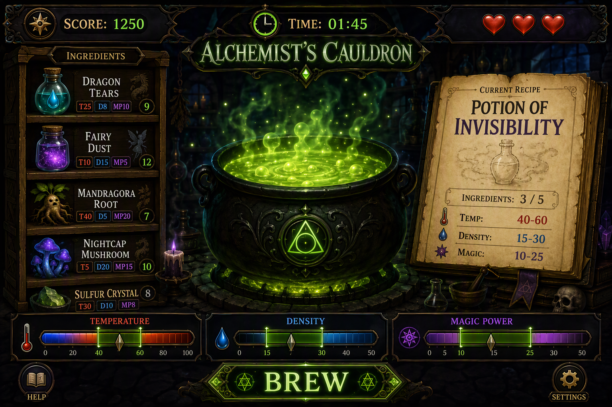
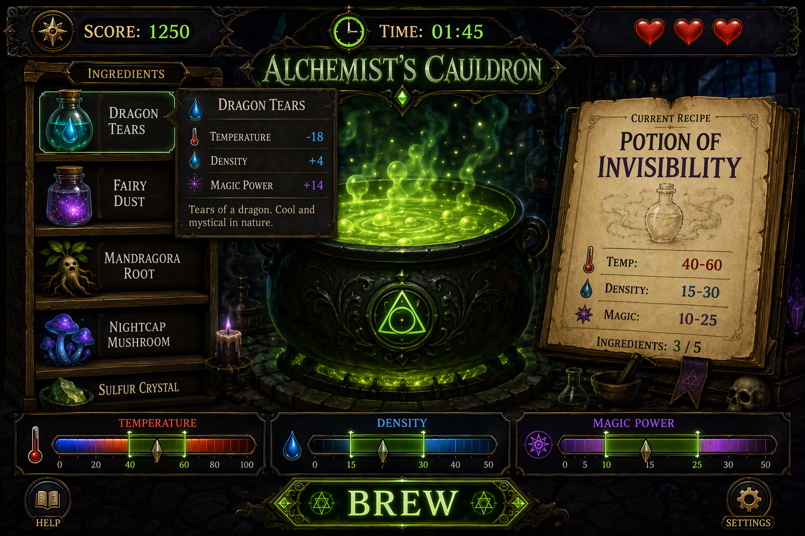

# 🧪 Alchemist's Cauldron

Mix ingredients, match 3 target ranges, and brew potions before time or lives run out.


## Levels and score

Students can stop after any finished level.

| Stage | What you add | Story points | Total score |
|---|---|:---:|:---:|
| 🟣 **Precondition 1** | Repository setup, tooling, folder structure and quality checks | 58 | 58 |
| 🟢 **Level 1 — Basic** | One full playable game with one fixed rule set | 170 | 228 |
| 🟡 **Level 2 — Extended** | Difficulty selection and save / continue | 50 | 278 |
| 🔴 **Level 3 — Full game** | Drag & drop, tooltip, reactions, Pour Out, keyboard shortcuts and visual feedback | 115 | 393 |

Maximum possible score: **393**.

## Repository workflow

Work in story branches and keep the history easy to review:

- create `story-1` from `main` / `master`, then create feature branches for individual tasks from the current story branch;
- keep commits small and step-by-step, following the RS School git convention;
- when a story is finished, open an unmerged PR from the story branch to the previous branch and submit that PR link in RS App via **Cross-Check: Submit**.

## Start screen

The game starts from a start screen. Before the first run, the shelf is empty, the cauldron is empty, the score and time are `0`, and there are no life icons yet. A centered **Start Game** button is shown instead of **Brew**.

It should also include a **Help** button that opens the rules for the game.

The **Settings** or **Menu** button opens the panel with actions the player uses outside the run itself, such as:

- choose the difficulty;
- continue the last valid game when it exists;
- start a new game;
- open the leaderboard.

### Level 1 — example screen

Ingredient cards show the 3 numbers directly and the stock badge (the number in a circle). The recipe panel shows the ingredient counter.



### Level 3 — example screen

Cards show only the icon, name and stock badge. The 3 numbers appear in a tooltip on hover.



> The pictures show the idea of the screen. Ingredient values, ingredient names and the stock numbers in the pictures may differ from the tables below (the real stock is random, 2–15). Use the tables in this README.

## How the game works

1. Start a game. The app picks one random recipe from the [recipe pool](#recipe-pool), and the recipe panel shows how many ingredients you may use, for example **Ingredients: 0 / 4**.
   When the run starts, the shelf is filled according to the chosen difficulty, the cauldron is still empty, and the score/time/lives switch from the start screen state to the active game state.
2. Add ingredients from the shelf to the cauldron. The counter grows with every ingredient (**1 / 4**, **2 / 4** …). At the maximum the shelf is blocked.
3. Watch the 3 bars: **Temperature**, **Density** and **Magic Power**.
4. Try to move every value into the recipe target zones.
5. Click **Brew** to check the mix. In Level 3, **Pour Out** is also available.
6. Keep brewing until time ends, you lose all lives, or the ingredients run out.

Every ingredient has a **limited stock**. The number on the shelf card shows how many portions are left (see [Ingredient stock](#ingredient-stock)).

Worked example round:

1. The selected recipe is **Moon Mist** from the recipe pool. It says: Temperature **32..42**, Density **12..22**, Magic Power **17..27**.
2. You add **Dragon Tears** `(+25, +8, +10)` and **Fairy Dust** `(+12, +9, +12)`.
3. The cauldron totals become **37 / 17 / 22**, and the counter shows **Ingredients: 2 / 4**.
4. Level 1 uses the **Medium** rules, so brew tolerance is **±8**.
5. The checked ranges become **24..50**, **4..30** and **9..35**.
6. `37 / 17 / 22` is inside all 3 checked ranges, so the brew succeeds.

## Difficulty table

Level 1 always uses the **Medium** column below. In Level 2, the player chooses the difficulty from the **Settings/Menu** panel on the start screen.

| Setting | Easy | Medium | Hard |
|---|:---:|:---:|:---:|
| Ingredients on shelf | 4 | 6 | 8 |
| Max ingredients in cauldron | 4 | 4 | 5 |
| Starting time | 180 s | 150 s | 150 s |
| Recipe tolerance | ±12 | ±8 | ±5 |
| Lives | 5 | 3 | 3 |
| Score per brew | 100 | 200 | 300 |
| Time bonus per brew | +15 s | +10 s | +5 s |
| Reactions | none | 2 reactions | 3 reactions |

Use this table as the single source of numbers.

## Ingredient catalogue

The game uses this fixed ordered list of ingredient types. Level 1 uses the first **6** ingredients. In Level 2, Easy uses the first **4**, Medium the first **6**, and Hard all **8**.

In Level 1 and Level 2, every card shows the 3 numbers directly. In Level 3, the card shows only the icon and name, and the numbers move to a tooltip.

| # | Ingredient | Temperature | Density | Magic Power |
|---|---|:---:|:---:|:---:|
| 1 | Dragon Tears | +25 | +8 | +10 |
| 2 | Fairy Dust | +12 | +9 | +12 |
| 3 | Frost Lotus | −18 | +4 | +14 |
| 4 | Mandrake Root | −5 | +20 | +8 |
| 5 | Caustic Acid | +10 | +14 | +22 |
| 6 | Essence of the Void | −20 | −10 | +40 |
| 7 | Phoenix Feather | +50 | −10 | +30 |
| 8 | Toad Slime | +5 | +30 | 0 |

## Ingredient stock

The shelf does not have unlimited ingredients. Stock is a resource that the player must use carefully.

| Rule | Value |
|---|---|
| Start stock | At the start of **every new game**, each ingredient on the shelf gets a **random whole number from 2 to 15**. Every ingredient gets its own number. |
| Where the player sees it | A number badge on the shelf card (in the pictures below it is the number in a circle). |
| Adding to the cauldron | Each added ingredient reduces its stock by **1**. |
| Empty ingredient | When the stock is **0**, the shelf slot becomes **empty**: no icon, dimmed, badge **0**. The slot stays in place and cannot be clicked, dragged or focused. |
| After Brew | Used ingredients are **spent**. They are **not** returned. The stock is **not** refilled. |
| Wrong mixture | A failed brew still spends the ingredients. |
| New game / Play again | A new random stock is created. |
| Continue Game (Level 2) | The saved stock is restored (not re-rolled). |

The stock is the same range (2–15) on all difficulties.

**Recipes and stock.** A new recipe is picked randomly from the table below for the current difficulty (see US 1.3).

**Out of ingredients.** The game ends with the message **Out of ingredients** when:

- the shelf is empty (all stocks are 0) and the cauldron is empty.

Time and lives still end the game as before.

## Recipe pool

Use one fixed table of **20** recipes. At the start of a new game and after each successful brew, pick **one random recipe** from the rows that:

- match the current difficulty.

The player sees only the recipe name and the 3 target ranges. During the game, calculate the current cauldron values and compare them with these ranges.

| # | Difficulty | Recipe name | Temperature | Density | Magic Power |
|---|---|---|:---:|:---:|:---:|
| 1 | Easy | Moon Mist | 32..42 | 12..22 | 17..27 |
| 2 | Easy | Root Bloom | 2..12 | 24..34 | 15..25 |
| 3 | Easy | Frost Steam | 2..12 | 7..17 | 19..29 |
| 4 | Easy | Quiet Swirl | -28..-18 | 19..29 | 17..27 |
| 5 | Easy | Bright Dew | 27..37 | 32..42 | 25..35 |
| 6 | Easy | Snow Dust | -16..-6 | 28..38 | 29..39 |
| 7 | Medium | Acid Spark | 17..27 | 18..28 | 29..39 |
| 8 | Medium | Void Ember | 0..10 | 0..10 | 45..55 |
| 9 | Medium | Heavy Acid | 0..10 | 29..39 | 25..35 |
| 10 | Medium | Frost Acid | -13..-3 | 13..23 | 31..41 |
| 11 | Medium | Dusty Void | -13..-3 | 0..10 | 47..57 |
| 12 | Medium | Dragon Void | 25..35 | 1..11 | 55..65 |
| 13 | Medium | Rooted Night | -18..-8 | 14..24 | 55..65 |
| 14 | Hard | Phoenix Pulse | 57..67 | 0..10 | 37..47 |
| 15 | Hard | Slime Crown | -5..5 | 45..55 | 3..13 |
| 16 | Hard | Void Flame | 25..35 | 0..10 | 60..70 |
| 17 | Hard | Acid Bog | 10..20 | 39..49 | 17..27 |
| 18 | Hard | Frozen Ash | 27..37 | 0..10 | 39..49 |
| 19 | Hard | Triple Eclipse | -20..-10 | 19..29 | 60..70 |
| 20 | Hard | Ember Soup | 62..72 | 24..34 | 37..47 |

The table above is the full reaction catalog. Each difficulty uses only its configured subset of reactions: none on Easy, 2 on Medium, and 3 on Hard.

## Words explained

- **state** — one object with all current game data.
- **localStorage** — browser storage that keeps small data after reload.
- **JSON** — text format used to save objects in `localStorage`.
- **function** — a named block of code that does one job.
- **type / interface** — a TypeScript description of data.
- **drag & drop** — move an item with the mouse into another area.
- **tooltip** — a small box with extra info near an element.
- **timestamp** — the current time from `Date.now()`.
- **stock** — how many portions of an ingredient are left on the shelf.

## How to start

Suggested order of work:

1. **Story 1** — prepare the repository, tooling, folder structure and quality checks.
2. **US 1.1** — create the ingredient data, shelf cards and cauldron list.
3. **US 1.2** — add the 3 bars and a pure function that sums ingredient values.
4. **US 1.3** — add the recipe table, random recipe selection, the recipe panel and the **Brew** check.
5. **US 1.4** and **US 1.5** — add timer, lives, pause and the game-over flow.
6. **US 1.6** — add the Top-10 leaderboard.
7. **US 2.1** and **US 2.2** — add difficulty selection, save and continue.
8. **US 3.1** to **US 3.6** — add drag & drop, tooltip, reactions, Pour Out, keyboard shortcuts and animations.

Suggested file structure:

```text
src/
  data/
    ingredients.ts
    recipes.ts
    difficulty.ts
    reactions.ts
  logic/
    calculate-cauldron.ts
    recipe-generator.ts
    stock.ts
    brew-check.ts
    timer.ts
  state/
    game-state.ts
  storage/
    save.ts
    leaderboard.ts
  ui/
    menu.ts
    shelf.ts
    cauldron.ts
    bars.ts
    dialogs.ts
  styles/
    style.css
```

## TypeScript types

```ts
type Difficulty = 'easy' | 'medium' | 'hard'; // Level 2+
type GameStatus = 'menu' | 'playing' | 'paused' | 'game-over';

interface IIngredient {
  id: string;
  name: string;
  icon: string;
  temperature: number;
  density: number;
  magicPower: number;
}

interface IRecipeRange {
  min: number;
  max: number;
}

interface IRecipe {
  id: string;
  name: string;
  difficulty: Difficulty;
  temperature: IRecipeRange;
  density: IRecipeRange;
  magicPower: IRecipeRange;
}

interface IGameState {
  status: GameStatus;
  score: number;
  timeLeft: number;
  lives: number;
  activeRecipe: IRecipe;
  cauldronIngredients: IIngredient[];
  shelfStock: Record<string, number>; // ingredient id -> portions left
  difficulty?: Difficulty; // Level 2+
  lastReactionId?: string | null; // Level 3+
}

interface IReaction {
  id: string;
  name: string;
  difficulty: Exclude<Difficulty, 'easy'>;
  isActive: (ingredients: IIngredient[]) => boolean;
  apply: (values: {
    temperature: number;
    density: number;
    magicPower: number;
  }) => {
    temperature: number;
    density: number;
    magicPower: number;
  };
}
```

## Precondition 1

| Story | Points |
|---|:---:|
| [Story 1](./precondition-user-story.md) Project Setup & Technical Base | 58 |
| **Precondition 1 points** | **58** |

## Level 1 stories

| Story | Points |
|---|:---:|
| [US 1.1](./user_story_1.1.md) Ingredient Shelf & Cauldron | 35 |
| [US 1.2](./user_story_1.2.md) Cauldron Parameter Bars | 25 |
| [US 1.3](./user_story_1.3.md) Recipe & Brewing Check | 45 |
| [US 1.4](./user_story_1.4.md) Timer & Game Over | 30 |
| [US 1.5](./user_story_1.5.md) Pause | 15 |
| [US 1.6](./user_story_1.6.md) Leaderboard (Top-10) | 20 |
| Precondition 1 points | 58 |
| **Level 1 story points** | **170** |
| Common requirements (listed separately, see [common requirements](./common-requirements.md)) | 30 |
| **Level 1 total score** | **228** |

## Level 2 stories

| Story | Points |
|---|:---:|
| [US 2.1](./user_story_2.1.md) Difficulty Selection | 25 |
| [US 2.2](./user_story_2.2.md) Auto-save & Continue Game | 25 |
| **Level 1 + Level 2 story points** | **220** |
| **Level 2 total score** | **278** |

Chemical reactions need the difficulty selection from Level 2, because Easy / Medium / Hard use different reaction sets.

## Level 3 stories

| Story | Points |
|---|:---:|
| [US 3.1](./user_story_3.1.md) Drag & Drop | 20 |
| [US 3.2](./user_story_3.2.md) Ingredient Tooltip | 15 |
| [US 3.3](./user_story_3.3.md) Chemical Reactions | 35 |
| [US 3.4](./user_story_3.4.md) Pour Out | 10 |
| [US 3.5](./user_story_3.5.md) Visual Feedback | 20 |
| [US 3.6](./user_story_3.6.md) Keyboard Shortcuts | 15 |
| **All story points** | **335** |
| **Level 3 total score** | **393** |

## Technical constraints

- Use **TypeScript** only. Do not use frameworks, game engines or other libraries.
- Do not use the `any` type.
- Use **CSS**, **SVG**, **Canvas** or text symbols for icons and shapes.
- Keep game rules in separate files from DOM rendering.
- Make the game work in the latest Google Chrome on screens from **375 px** to **1920 px** wide.

See [common requirements](./common-requirements.md) for the shared scoring rules, penalties and repository rules.