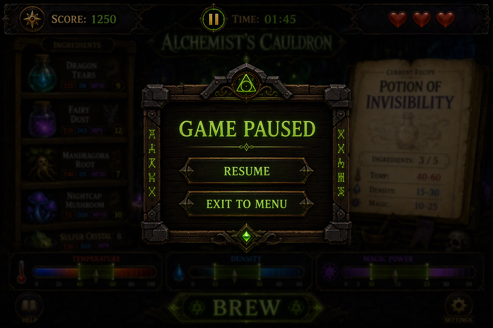

# US 1.5: Pause (15 points)

**Level 1 — Basic**

## Goal

The player can stop the game and continue later from the same place.

## What to build

- [ ] Show a **Pause** button during play.
- [ ] When paused, stop the timer and block gameplay actions.
- [ ] Hide or blur the play field so the player cannot plan moves.
- [ ] Show a dialog with **Resume** and **Exit to Menu**.
- [ ] Resume continues the same game. Exit to Menu leaves the run and returns to the start screen.
- [ ] Pause the game automatically when the browser tab becomes hidden.

## Hints

1. Keep one state value like `status: 'playing' | 'paused'`.
2. Check `state.status` first in click handlers.
3. Add the hidden-tab pause with `document.visibilitychange`.
4. Reuse the same dialog layout for manual pause and continue.
