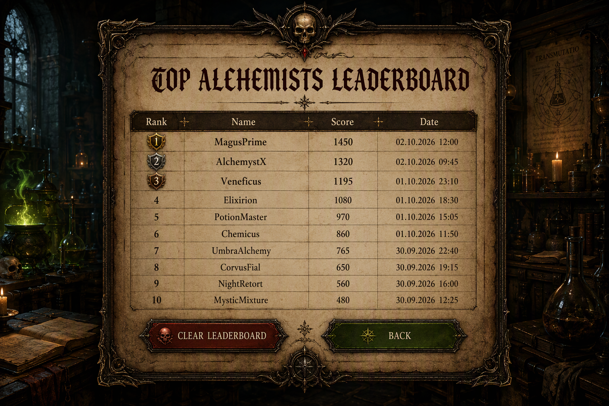
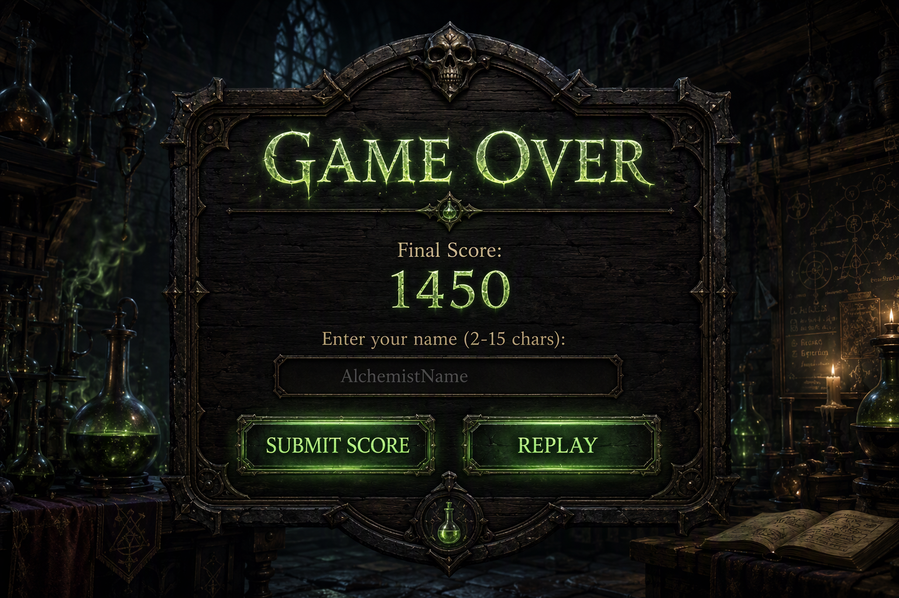

# US 1.6: Leaderboard (Top-10) (20 points)

**Level 1 — Basic**

## Goal

After the game ends, the player can compare the result with earlier results.

## What to build

- [ ] Show a **Game Over** screen with the final score.
- [ ] If the score is in the Top-10, ask the player for a name.
- [ ] Accept names with **2–15** characters: letters, digits, space, `_` and `-`.
- [ ] Keep one Top-10 list in `localStorage` for Level 1.
- [ ] Show these columns: rank, name, score and date.
- [ ] Format the date as `DD.MM.YYYY HH:MM`.
- [ ] Sort by score from high to low. If two scores are equal, the earlier result stays higher.
- [ ] Open the leaderboard from the start screen and from the Game Over screen. Add **Clear Leaderboard** with a custom in-app confirmation dialog, and never crash on `localStorage` errors.

## Hints

1. Save leaderboard entries as one array in `localStorage`.
2. Validate the player name before saving.
3. After insertion, sort the array and keep only the first 10 items.
4. Wrap `localStorage` read and write calls in `try/catch`.
